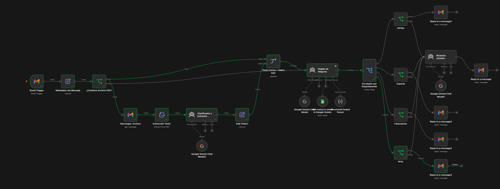
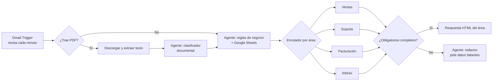

# Triaje de correos con agentes de IA (n8n + Gemini)

Flujo en **n8n** que lee los correos que llegan a una bandeja de Gmail, los clasifica en el área correcta (Ventas, Soporte, Facturación o RRHH), revisa si traen la información necesaria (también dentro de los PDF adjuntos) y responde automáticamente con un correo en HTML.

> **Tipo:** proyecto personal / prueba de concepto sobre una empresa ficticia, *Soluciones Tec*.



---

## Problema

Lo hice para **aprender a construir agentes de IA** con un caso que se parezca a una empresa real. Busqué uno con varios pasos: entender un texto libre, leer un PDF, consultar reglas externas, tomar una decisión y responder.

El caso elegido es la bandeja de entrada compartida de una empresa. Alguien tiene que leer cada correo, decidir a qué área va y, muchas veces, contestar pidiendo los datos que faltan. Es un trabajo repetitivo, lento y propenso a errores.

**Pregunta:** ¿puede un flujo con agentes de IA clasificar un correo, validar si trae la información mínima para atenderlo y dar la primera respuesta sin intervención humana?

## Datos

- **Entrada:** correos que llegan a una cuenta de Gmail de pruebas, con o sin un PDF adjunto (facturas, hojas de vida, reportes de error).
- **Reglas de negocio:** una hoja de Google Sheets con una fila por área y las columnas `Categoria`, `Campos_Obligatorios` y `Campos_Opcionales`. Así se cambian las reglas sin tocar el flujo.
- **Casos de prueba:** 4 correos escritos a mano, uno por área.

## Enfoque

El flujo usa **tres agentes con tareas separadas**, cada uno con su propio prompt:

| Agente | Qué hace |
|---|---|
| **Clasificador y extractor documental** | Si el correo trae un PDF, lee su texto y lo clasifica (factura o cobro, hoja de vida, documento fiscal, reporte de error, contrato u otro). Extrae los datos clave según el tipo: emisor, NIT y total en una factura; nombre, contacto y experiencia en una hoja de vida. |
| **Reglas de negocio** | Junta el texto del correo con lo extraído del PDF, consulta la hoja de Google Sheets con las reglas de cada área, decide la categoría y revisa qué campos obligatorios y opcionales se recibieron y cuáles faltan. |
| **Redactor asistido** | Si faltan datos obligatorios, escribe un correo cordial en HTML que muestra lo recibido y pide exactamente lo que falta. |

### Recorrido de un correo



### Salida estructurada

Para que el flujo no dependa de texto libre, el agente de reglas de negocio responde con un **JSON validado por esquema** (`Structured Output Parser`). La categoría solo puede tomar 4 valores, así que los nodos `Switch` e `If` pueden decidir sin ambigüedad:

```json
{
  "categoria": "Facturacion",
  "tiene_adjunto": true,
  "tipo_adjunto": "FACTURA",
  "resumen": "...",
  "obligatorios_completos": false,
  "obligatorios_obtenidos": [{ "campo": "NIT", "valor": "..." }],
  "obligatorios_faltantes": ["Total"],
  "opcionales_obtenidos": [],
  "opcionales_faltantes": ["Concepto"]
}
```

### Respuesta de cada área

| Área | Si los datos están completos, responde con… |
|---|---|
| Ventas | Confirmación y botón para agendar reunión en Google Meet |
| Soporte | Ticket con tiempo de atención prioritaria (< 15 min) |
| Facturación | Constancia de radicación, con respuesta en 3 días hábiles |
| RRHH | Confirmación de ingreso a la base de talento |

## Resultados

- Probé el flujo con **4 correos, uno por área**. Cada uno llegó al área esperada y recibió su respuesta automática, incluidos los que traían PDF adjunto.
- El esquema JSON evitó que el modelo respondiera con formatos inesperados: el enrutamiento siempre recibió una categoría válida.
- Sacar las reglas a Google Sheets permite agregar o cambiar campos obligatorios sin editar el flujo.

**Limitación:** 4 correos alcanzan para validar que el flujo funciona, no para medir qué tan bien clasifica. El siguiente paso es un conjunto de prueba más grande (ver *Próximos pasos*).

## Tecnologías

- **n8n** (autoalojado con Docker): orquestación del flujo
- **Google Gemini** (`gemini-3.5-flash-lite`): modelo de los tres agentes
- **Gmail API** (OAuth2): lectura de correos, descarga de adjuntos y respuestas
- **Google Sheets**: reglas de negocio por área
- **Extract from File**: texto de los PDF
- **Structured Output Parser**: validación de la salida con JSON Schema
- **HTML + CSS en línea**: plantillas de respuesta

## Cómo ejecutarlo

1. **Levantar n8n con Docker:**
   ```bash
   docker volume create n8n_data
   docker run -it --rm --name n8n -p 5678:5678 -v n8n_data:/home/node/.n8n docker.n8n.io/n8nio/n8n
   ```
   Abrir `http://localhost:5678`.
2. **Importar el flujo:** *Workflows → Import from File →* `CorreoIA.json`.
3. **Crear las credenciales** en n8n:
   - Gmail OAuth2 (cuenta de pruebas, no una personal)
   - Google Sheets OAuth2
   - API key de Google Gemini (Google AI Studio)
4. **Crear la hoja de reglas** en Google Sheets con las columnas `Categoria`, `Campos_Obligatorios` y `Campos_Opcionales` (una fila por área) y seleccionarla en el nodo *Get row(s) in sheet*.
5. **Activar el flujo** y enviar un correo de prueba a la cuenta configurada.

## Estructura

```text
├── CorreoIA.json                # Flujo de n8n para importar
├── proyecto_triaje_ia_n8n.md    # Documentación técnica detallada
├── docs/img/flujo-n8n.png       # Captura del flujo
└── README.md
```

Las respuestas de prueba originales no se publican porque contienen correos y teléfonos reales.

## Próximos pasos

- [ ] Armar un conjunto de 30 a 50 correos variados (ambiguos, sin datos, en otro idioma) y medir el % de aciertos por área
- [ ] Guardar cada correo procesado en una hoja de registro para tener métricas (volumen por área, % con datos incompletos, tiempo de respuesta)
- [ ] Manejar correos que no pertenecen a ninguna área
- [ ] Probar el mismo flujo con la API de Claude y comparar resultados
